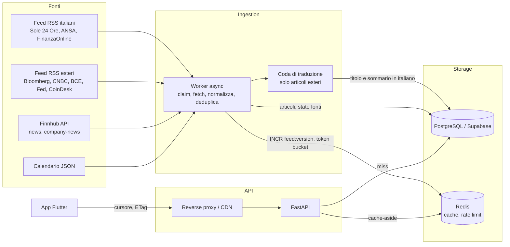

# ClearMarket: architettura

## 1. Flusso dati



Ingestion e lettura sono separate: l'API non chiama mai un provider esterno, quindi la
latenza e la disponibilita' del feed non dipendono da loro. Se un provider cade, il feed
resta servito con i dati gia' raccolti.

| Fase | Dove | Cosa fa |
|---|---|---|
| Claim | `worker.py`, `_CLAIM_SQL` | `FOR UPDATE SKIP LOCKED` con lease: piu' repliche non si sovrappongono, una replica morta rilascia la fonte alla scadenza |
| Fetch | `sources.py` | Conditional GET per RSS e calendario, `minId` per Finnhub |
| Normalizzazione | `normalize.py` | Pulizia HTML, estratto di 280 caratteri, ticker, categoria, sentiment |
| Deduplicazione | `dedupe.py`, `worker.py` | Tre livelli, vedi §3 |
| Traduzione | `translate.py` | Coda asincrona: l'articolo estero resta nascosto finche' non e' tradotto |
| Invalidazione | `cache.py` | `INCR feed:version` solo se ci sono articoli visibili nuovi |

## 2. Rate limit e refresh in background

**Verso i provider**

- **Budget condiviso.** Token bucket atomico in Lua su Redis (`ratelimit.py`), a 50
  chiamate/min contro le 60 dichiarate da Finnhub. Tutte le repliche attingono allo stesso
  bucket; il burst e' limitato a un sesto del budget.
- **Chiedere solo il nuovo.** ETag e `If-Modified-Since` sugli RSS: un 304 non costa
  parsing ne' scritture. `minId` su Finnhub.
- **Una sola coda per i ticker.** Le news per ticker costano una chiamata per simbolo:
  `watched_symbols` scorre a rotazione l'unione delle watchlist, 10 simboli a ciclo, dai
  piu' seguiti. Il costo cresce con i ticker distinti, non con gli utenti.
- **Intervalli legati al mercato** (`schedule.py`), con jitter del ±10%. Dal lunedi' al
  venerdi', 08:30-22:30 ora di Roma: ogni 5-10 minuti (`poll_interval_s`). Di notte e nel
  weekend: ogni 30-60 minuti (`closed_poll_interval_s`), senza mai scavalcare l'apertura.
  Il calendario resta a 60 minuti. Le festivita' di borsa contano come giorni aperti.
- **Reazione agli errori.** `Retry-After` su 429 e azzeramento del bucket per tutte le
  repliche; backoff esponenziale fino a 1 ora sugli altri errori. Una fonte guasta non
  blocca le altre e lo stato resta consultabile in `sources.last_error`.

**In ingresso:** finestra fissa per IP, 120 richieste/min. Con Redis giu' il limitatore
lascia passare. `X-Forwarded-For` e' ignorato finche' `TRUSTED_PROXY_HOPS` e' 0, perche' un
client potrebbe falsificarlo.

Il worker gira come processo a se' stante. Il polling lato dispositivo non serve: il telefono
legge sempre dalla nostra API.

## 3. Deduplicazione

| Livello | Chiave | Finestra | Esito |
|---|---|---|---|
| L1 | SHA-256 di host + path + query, senza tracking, `www`, schema | sempre | scartato (`UNIQUE`) |
| L2 | SHA-256 del titolo normalizzato | ±48 ore | salvato, nascosto |
| L3 | `similarity()` di `pg_trgm` ≥ 0,72 **e** stessa firma del titolo | ±12 ore | salvato, nascosto |

- La finestra di L2 esiste perche' "Fed holds rates steady" torna a ogni riunione ed e'
  ogni volta una notizia nuova.
- La firma di L3 (numeri e nomi propri) esiste perche' i soli trigrammi fondono "Fed holds
  rates steady" con "ECB holds rates steady": un test reale l'ha dimostrato. Allo stesso modo
  "rise 3%" e "rise 4%" restano distinti.
- L2 e L3 impostano `duplicate_of` invece di cancellare, quindi un falso positivo si corregge
  con una UPDATE. La stessa colonna permette in futuro di mostrare "riportata anche da...".

## 3-bis. Lingua e traduzione

Il feed mostra solo testo italiano. La colonna generata `articles.visible` esclude i doppioni
e gli articoli con traduzione `pending` o `failed`, quindi nessuna query puo' dimenticare il filtro.

1. Le fonti con `sources.language = 'it'` passano direttamente.
2. Le altre vengono salvate con il testo originale e stato `pending`. Salvarle prima di tradurre
   evita di perderle: dopo un 304 il feed non le riproporrebbe.
3. `TranslationQueue` traduce i piu' recenti, a lotti, in un ciclo separato dal polling.
4. Ticker, categoria, sentiment e deduplicazione usano il testo originale, conservato in
   `title_original` e `summary_original`.
5. Con quota finita il backend va in pausa per un'ora e l'articolo non consuma tentativi. Dopo 5
   errori veri passa a `failed`.

| Backend | Chiave | Limite | Ruolo |
|---|---|---|---|
| DeepL API | si' | quota mensile del piano Free | Primario consigliato; provato solo con risposte simulate |
| MyMemory | no | circa 5.000 caratteri al giorno senza account | Riserva e sviluppo; provato dal vivo |

Il primo avvio trova circa 160 articoli esteri, oltre la quota giornaliera di MyMemory: senza
DeepL la gran parte resta nascosta e il feed si regge sulle fonti italiane.

`deep-translator` e' stato scartato: il suo backend Google riceve la pagina anti-bot di Google
(HTTP 429 su `/sorry`). Non abbiamo aggirato quel blocco con altri endpoint non ufficiali.

Fonti non integrate: Milano Finanza e Teleborsa non espongono un RSS pubblico, e Reuters ha
chiuso i suoi. Le notizie Reuters possono arrivare tramite Finnhub. Non facciamo scraping.
Investing.com Italia ha un RSS funzionante ma e' stato escluso: i suoi flash su singoli titoli
occupavano l'intera Top News.

Limite: lo stesso fatto riportato da una fonte italiana e da una estera appare due volte, perche'
la deduplicazione confronta titoli nella stessa lingua.

## 4. Modello dati e contratto API

Schema: [`001_init.sql`](../backend/migrations/001_init.sql). Seed:
[`002_seed.sql`](../backend/migrations/002_seed.sql). Oltre alle quattro tabelle richieste ci
sono `user_bookmarks` ed `economic_events`. Fonti italiane e traduzione:
[`003_italian_feed.sql`](../backend/migrations/003_italian_feed.sql).

`GET /api/v1/feed?scope=top&category=macro&ticker=AAPL&limit=20&cursor=...`

```json
{
  "data": [{
    "id": "7f0f5b7e-3c54-4c37-a9a0-6a7ac2c3a2f1",
    "title": "Nvidia jumps on demand",
    "summary": "Estratto di massimo 280 caratteri",
    "source": { "slug": "finnhub-general", "name": "Finnhub" },
    "source_url": "https://example.com/story",
    "translated": true,
    "published_at": "2026-11-05T09:00:00+00:00",
    "category": "stocks_us",
    "related_tickers": ["NVDA"],
    "sentiment": { "label": "positive", "score": 0.5 }
  }],
  "page_info": { "next_cursor": "eyJ0Ijoi...", "has_more": true, "limit": 20 }
}
```

| Rotta | Auth | Note |
|---|---|---|
| `GET /api/v1/feed` | no | `scope`, `category`, `ticker`, `limit`, `cursor`; ETag e 304 |
| `GET /api/v1/feed/watchlist` | si' | Ticker **o** categorie dell'utente |
| `GET /api/v1/calendar` | no | `date`, `tz` IANA, `country`, `impact` |
| `GET /api/v1/categories` | no | Tassonomia |
| `GET`, `PUT /api/v1/me/watchlist` | si' | PUT idempotente dello stato completo |
| `GET /api/v1/me/bookmarks`, `PUT`, `DELETE .../{id}` | si' | L'app non ha ancora una UI per i bookmark |

**Paginazione.** Il cursore codifica `(published_at, id)` e la query usa un confronto di riga
coperto dall'indice `articles_feed_idx`. Rispetto a `OFFSET`, il costo non cresce con la
profondita' e le notizie nuove non causano righe doppie o saltate.

**Cache.** Chiave `feed:v{version}:{hash dei parametri}`, freschezza di 30 secondi, copia
conservata per 300. Alla scadenza un solo processo ricalcola e gli altri servono la copia
stale. Se Postgres fallisce si serve la copia stale; se Redis fallisce si legge da Postgres.
La cache e' per filtro, non per utente: chi segue gli stessi ticker condivide la voce.

## 5. Notifiche push (FCM)

1. Tabella `user_devices (user_id, fcm_token, platform, locale, last_seen_at)`; il token si
   aggiorna a ogni avvio e su `onTokenRefresh`.
2. Un outbox, non una chiamata diretta dal worker: l'inserimento dell'articolo e la riga
   `notification_outbox` stanno nella stessa transazione e un processo separato invia. Cosi'
   un riavvio non perde notifiche.
3. Topic FCM per categorie e ticker popolari (`ticker_NVDA`): il fan-out e' di Google e costa
   una chiamata. Token diretti solo per preferenze davvero individuali.
4. Filtrare molto: solo fonti primarie o eventi ad alto impatto, massimo 2-3 push all'ora per
   utente, ore silenziose nel fuso del dispositivo, chiave di collasso per storia. In un'app di
   news il primo motivo di disinstallazione e' il rumore.
5. Il payload porta solo `article_id` e titolo; l'app legge il resto dall'API. Su iOS serve
   APNs e il permesso va chiesto dopo che l'utente ha seguito qualcosa, non all'avvio.
6. Rimuovere i token su `UNREGISTERED`.

## 6. Offline-first

- **Cache locale con Drift (SQLite).** La lista mostra subito la tabella locale e poi
  aggiorna dalla rete (stale-while-revalidate). Tenere 200 articoli per feed, con potatura.
- **Cursori.** Il refresh sostituisce la testa della lista; il cursore locale resta valido
  perche' keyset, quindi lo scroll riprende dalla coda salvata.
- **ETag.** L'app puo' inviare `If-None-Match` sulla prima pagina: l'API risponde gia' 304.
  In Dio va gestito con `validateStatus`.
- **Scritture.** Watchlist e bookmark in una coda locale idempotente, svuotata al ritorno
  della rete. Il `PUT` della watchlist e' gia' last-write-wins.
- **Sfondo.** `workmanager` su Android e `BGAppRefreshTask` su iOS per prescaricare la prima
  pagina; iOS decide lui quando eseguire, quindi e' un miglioramento, non una garanzia.
- **Indicatore.** Mostrare "aggiornato alle 14:32" quando i dati sono offline: una notizia di
  mercato vecchia presentata come attuale e' un rischio reale per l'utente.

## 7. Rischi da chiudere prima del lancio

| Rischio | Dettaglio | Azione |
|---|---|---|
| **Licenze contenuti** | Salviamo titolo, estratto e link, ma la ridistribuzione commerciale di feed RSS e dati Finnhub dipende dai termini di ciascun editore | Verifica legale per fonte; piano commerciale o licenza se necessario |
| **Calendario** | `nfs.faireconomy.media` e' un JSON pubblico non ufficiale, funzionante il 2026-11-05, senza SLA ne' licenza chiara. Copre solo la settimana corrente | Va bene per l'MVP interno; in produzione passare a un fornitore con contratto. Basta sostituire `fetch_ff_calendar` |
| **Finnhub** | Limiti e copertura del piano gratuito non verificati sui documenti ufficiali. I titoli UE possono non essere coperti: il codice tratta il 403 come "simbolo non disponibile" e per quei ticker conta sull'estrazione dal testo | Provare con una chiave reale |
| **Sentiment** | Lessico minimo, inglese e italiano. Sui feed reali ha sbagliato: "fear gauge surges" e un rialzo dei tassi sono risultati positivi | Mostrarlo come indicazione, oppure spegnerlo finche' non c'e' FinBERT |
| **Normativa** | Il sentiment su un singolo titolo puo' sembrare una raccomandazione | Disclaimer "non e' consulenza finanziaria" e parere legale prima del lancio UE |
| **Traduzioni** | Tradurre e ripubblicare estratti altrui e' un'opera derivata; la qualita' automatica puo' alterare numeri e nomi. MyMemory ha prodotto "SBI back crypto assicuratore" | Verifica legale; DeepL per la qualita'; etichetta "Tradotto" gia' presente nella card |
| **Calendario in inglese** | I nomi degli eventi del tab Calendario non vengono tradotti | Tradurli o usare un fornitore italiano |
| **Auth Supabase** | I test coprono la verifica HS256; il ramo JWKS e il login anonimo non sono stati eseguiti | Provare con un progetto reale |

## 8. Step successivi

1. Provare Supabase e Finnhub con credenziali reali, poi l'app su emulatore e iPhone.
2. Metriche: latenza p95 di `/feed`, hit rate, eta' dell'ultimo articolo per fonte. Allarme se
   `last_success_at` di una fonte supera di 3 volte il suo intervallo.
3. Retention: archiviare gli articoli oltre 12 mesi, partizionare `articles` per mese.
4. Cache locale Drift (§6), poi notifiche FCM (§5), poi UI bookmark.
5. Sentiment con FinBERT in un worker separato, che aggiorna gli articoli in modo asincrono.
6. Aggiornamenti in tempo reale via SSE per le breaking news, solo se i dati d'uso lo
   giustificano: con TTL di 30 secondi il pull-to-refresh copre gran parte dei casi.
