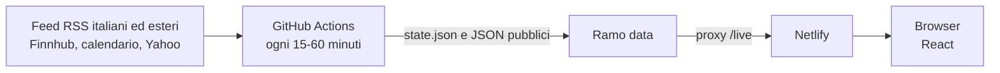

# ClearMarket: architettura

Non ci sono database né processi sempre attivi. La memoria tra un giro e l'altro è `state.json`
sul ramo `data`, sovrascritto con un solo commit per non far crescere la cronologia. Il sito legge
tre file (`feed.json`, `markets.json`, `calendar.json`) e filtra nel browser categorie, ricerca e
watchlist. Se `/live` non risponde usa l'istantanea in `web/public/data`.

## Un giro

1. **Raccolta:** richieste condizionali con ETag, `minId` per Finnhub. Una fonte guasta non blocca le
   altre; dopo un 429 viene saltata fino a `Retry-After`.
2. **Normalizzazione:** testo pulito, estratto di 280 caratteri, ticker, categoria, sentiment.
3. **Deduplicazione:** URL canonica; stesso titolo entro 48 ore; titolo simile entro 12 ore con gli
   stessi numeri e nomi propri. I doppioni restano con `duplicate_of` e non vengono mostrati.
4. **Traduzione:** gli articoli esteri restano nascosti finché non sono tradotti. Si parte dai più
   recenti, entro un tetto giornaliero che protegge le quote gratuite.
5. **Mercati:** quotazioni Yahoo e spread letto dalle notizie italiane.
6. **Pubblicazione:** ultimi 500 articoli; lo stato conserva 30 giorni.

## Cadenza

Il cron gira circa ogni 15 minuti nelle ore di mercato e ogni ora il resto del tempo. GitHub può
ritardare i job, quindi non è un servizio in tempo reale. Con un repository pubblico i minuti di
Actions sono gratuiti. GitHub può sospendere i job programmati dopo un lungo periodo senza attività
nel repository: in quel caso si riattivano dalla scheda Actions.

## Traduzione

| Backend | Chiave | Tetto giornaliero | Stato |
|---|---|---|---|
| DeepL API Free | `DEEPL_API_KEY` | 15.000 caratteri | Primario consigliato; provato solo con risposte simulate |
| MyMemory | no | 4.500 caratteri | Riserva; provato dal vivo da un PC, non da GitHub |

`deep-translator` è stato scartato: il suo backend Google riceve la pagina anti-bot di Google.
Non abbiamo aggirato quel blocco.

## Fonti non integrate

Milano Finanza e Teleborsa non espongono un RSS pubblico; Reuters ha chiuso i suoi. Investing.com
Italia è escluso perché i suoi flash su singoli titoli occupavano l'intero feed.

## Rischi

| Rischio | Dettaglio | Azione |
|---|---|---|
| **Licenze** | Titoli, estratti e traduzioni di testate terze vengono ripubblicati su un sito pubblico e nel repository | Verifica legale per fonte prima di promuovere il sito |
| **Quotazioni** | Endpoint Yahoo non ufficiale, ritardato e senza licenza chiara; da GitHub può essere bloccato. Lo spread si aggiorna solo con le notizie e non ha variazione | Fornitore a contratto |
| **Calendario** | JSON pubblico non ufficiale, solo settimana corrente, nomi in inglese | Fornitore a contratto |
| **Sentiment** | Lessico semplice, può sbagliare | Modello dedicato o rimozione |
| **Doppioni tra lingue** | Lo stesso fatto da fonte italiana ed estera appare due volte | Confronto sui testi tradotti |
| **Normativa** | Il sito non è consulenza finanziaria | Parere legale prima di un lancio pubblico |
